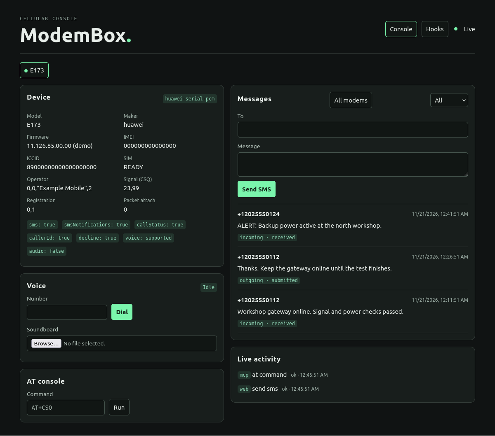

# ModemBox

ModemBox runs on the Linux host that owns your USB modem. Use its browser console to send and receive SMS, inspect the device and SIM, and make calls on supported hardware. The same instance exposes a REST API, WebSockets, and MCP.

| Guide | What it covers |
|---|---|
| [Install ModemBox](install.md) | Docker Compose, direct Docker, upgrades, and data storage |
| [Browser console](console.md) | Unlock a SIM, work with SMS, and use call audio |
| [Devices and configuration](devices.md) | USB discovery, modem capabilities, SIM PINs, and runtime settings |
| [API reference](api.md) | REST endpoints, events, and call audio |
| [MCP and agent integrations](mcp.md) | Client setup, packaged skills, and the tool list |
| [SMS and call hooks](hooks.md) | Forward SMS, call webhooks, and decline incoming calls |

ModemBox is licensed under [AGPL-3.0-only](https://github.com/psyb0t/docker-modembox/blob/main/LICENSE). See the [source repository](https://github.com/psyb0t/docker-modembox) for development commands and release notes.
